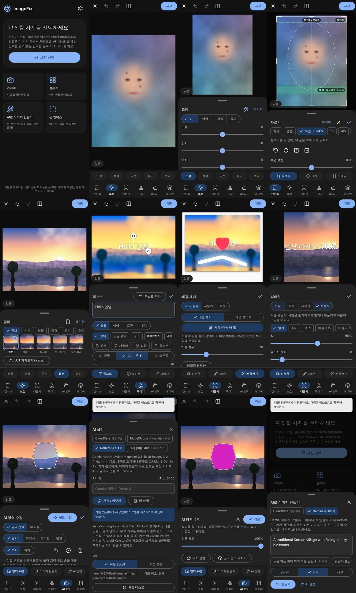

# ImageFix — 이미지 편집 앱 (Android APK)

사진 보정·필터·자르기부터 텍스트·스티커·리터치·콜라주까지 한 앱에서. 기본은 **오프라인**으로 동작하고, 인터넷 권한은 선택 기능인 **AI 기능**(AI 수정 · AI로 이미지 만들기 — Cloudflare · ModelScope · Gemini · fal.ai, 내 키/토큰으로 선택한 영역/문구만 전송)에만 쓰입니다. 쓰지 않으면 사진은 기기 밖으로 나가지 않습니다.

- 빌드 날짜: 2026-11-15 · 버전 2.0.0 · Android 8.0(API 26) 이상, WebView 90+ (Play 스토어 자동 업데이트 기준 대부분 충족)
- APK: [`release/ImageFix_2026-11-15.apk`](release/ImageFix_2026-11-15.apk)



> 스크린샷의 사진은 **합성 샘플**이고, AI 화면(생성 결과·채워진 영역의 단색 이미지, 계정 ID·키 표시)은 **테스트용 모의 서버**로 만든 예시라 실제 AI 결과가 아닙니다. 여권 가이드 화면의 인물도 합성 샘플입니다.

## 설치 · 업데이트
- **앱 안에서 업데이트**(1.8.0~): 시작할 때(12시간에 한 번) GitHub 의 `release/latest.json` 을 읽어 새 버전이 있으면 알려 줘요. 설정 → **새 버전 확인** 으로도 확인하고, 설정에서 자동 확인을 끌 수 있어요. 확인은 공개 파일을 읽기만 하고 아무것도 보내지 않아요. 업데이트를 누르면 같은 저장소의 APK 를 내려받아 SHA-256 을 확인한 뒤 안드로이드 설치 화면으로 넘겨요(같은 서명키가 아니면 설치되지 않아요). 처음 한 번은 “이 출처의 앱 설치 허용”이 필요해요. 1.7.x 이하는 이 기능이 없어서 1.8.0 을 직접 설치해야 해요.
- 새 버전을 낼 때: `./scripts/build_apk.sh` 가 APK 와 `release/latest.json` 을 만들어요 → 둘을 같이 커밋·푸시하면 앱이 새 버전을 알아봐요(`release/NOTES.txt` 가 안내 문구).
1. 폰에서 APK 다운로드 → 열기 (“출처를 알 수 없는 앱 설치 허용” 필요)
2. 개인용 서명키(`keystore/imagefix.jks`)로 서명돼 있어, 이후 버전은 같은 키로 만들면 덮어쓰기 설치됩니다.
3. 갤러리/파일 앱의 **공유 · 편집 · 연결 앱** 목록에서도 ImageFix 가 나타납니다.

## 기능
**도구 구성**: 하단에는 상위 목록 6개만 보이고, 누르면 그 위에 하위 목록(5개 이하)이 펼쳐집니다. 하위를 누르면 도구 패널이 열려요.

| 상위 | 하위 |
|---|---|
| **캔버스** | 자르기 · 크기 · 프레임 |
| **보정** | 조정 · 색상 · 곡선 · 필터 · 효과 |
| **다듬기** | 리터치 · 브러시 · 배경 제거 · **체형** |
| **꾸미기** | 텍스트 · 스티커 · 그리기 |
| **AI 도구** | 영역 수정 · 이미지 만들기 · AI 설정 |
| **레이어** | (바로 열림) |

패널(시트) 높이는 **위쪽 손잡이(—)를 잡고 위아래로 끌어** 바꿀 수 있어요(도구마다 기억, 누르면 접기/펼치기, 제목 줄·키보드 ↑↓도 가능). 자세한 내용: [`docs/TOOL_LAYOUT_2026-11-15.md`](docs/TOOL_LAYOUT_2026-11-15.md)

| 도구 | 내용 |
|---|---|
| 자르기 | 비율 13종(**여권 3.5×4.5 — 얼굴 크기 가이드**: 정수리 선·턱 끝 띠·얼굴 틀, 얼굴 3.2~3.6cm), 핸들 조절, 90° 회전, 좌우/상하 뒤집기, 수평 보정(±45°), 수직/수평 원근 |
| 크기 | 가로×세로 px·배율 지정, 프리셋 — SNS(인스타 1:1·4:5·스토리·유튜브 썸네일·페이스북 커버·X 헤더·카카오 프로필), 화면(HD~4K·휴대폰 배경), 인쇄·증명(여권·증명사진·4×6·5×7·A4). 맞춤 방식: 채우기(자름)·여백(블러/단색)·늘이기. 저장 결과가 지정 크기와 정확히 일치 |
| 조정 | 노출·밝기·대비·하이라이트·그림자·화이트·블랙·안개 제거·페이드, 채도·생동감·색온도·틴트·색상 회전, 선명도·명료도·질감·노이즈 제거, 비네팅·그레인, 자동 보정, 히스토그램 |
| 필터 | 36종(기본·인물·풍경·음식·흑백·빈티지·시네마·무드) + 강도, 나의 프리셋 저장, `.cube` LUT 가져오기 |
| 색상 | HSL 8색, 컬러 그레이딩(하이라이트/섀도), 흑백 채널 믹서, 세피아 |
| 곡선 | RGB/R/G/B 커브, 점 추가·이동·삭제, 숫자 입력·키보드 보정, 프리셋 |
| 효과 | 블러(일반·모션·줌·틸트시프트·원형 초점), 모자이크·하프톤·유화·스케치·만화·엠보스·외곽선·포스터·솔라라이즈·듀오톤 등 아트, 글로우·소프트포커스·빛샘·빛망울·눈, 소용돌이·볼록/오목·물결·어안·거울·만화경, 글리치·색수차·RGB 분리·VHS (스택 방식) |
| 리터치 | 치유, 복제, 지우기(주변 질감으로 채움), **픽셀 유동화**(밀기·확대·축소·비틀기 ↻↺·복원) |
| AI 도구 · 영역 수정 | 올가미·브러시·사각형·원형으로 **영역 선택**(추가/빼기/반전/넓히기/부드럽게) → 그 영역(+주변)만 AI 에 요청 → **선택 안쪽에만** 합성되는 비파괴 레이어. **"문구로 채우기"**(사진 미전송)와 홈의 **"AI로 이미지 만들기"**도 있음. 제공자 5종(+ deAPI 편집): **Cloudflare Workers AI**(하루 무료 — FLUX.2 편집 · FLUX.1 schnell 생성 · 한국어→영어 번역) · **ModelScope Qwen-Image-Edit**(무료 체험 토큰, 사진 편집) · **Google Gemini**(내 키, 편집·생성) · **fal.ai FLUX.1 Fill**(진짜 마스크 인페인팅). OpenAI·OpenRouter·Pollinations 는 삭제했습니다. AI 요청은 **앱을 나가도 계속**되고(진행 중 알림 → 끝나면 알림), 키는 기기 Keystore 에 암호화 저장(Keystore 를 못 쓰는 기기는 앱 전용 저장소에 암호화 — 설정에 표시), 첫 요청 전 동의. 자세한 내용: [`docs/AI_EDIT_2026-11-14.md`](docs/AI_EDIT_2026-11-14.md) · 무료 모델 조사: [`docs/FREE_IMAGE_MODELS_2026-11-15.md`](docs/FREE_IMAGE_MODELS_2026-11-15.md) |
| 체형 (얼굴·체형 보정) | 올가미/브러시로 **인물만 선택** → **폭**(허리·팔뚝·허벅지·턱선) · **길이**(다리) · **확대·축소**(눈·코·턱)를 조절. 변형은 인물 픽셀에만 걸리고 **배경은 움직이지 않아요**(줄어서 드러난 배경은 주변 색·입자감으로 채움). 여러 조절을 쌓아 한 번에 적용하는 비파괴 레이어. 자세한 내용: [`docs/BODY_RESHAPE_2026-11-16.md`](docs/BODY_RESHAPE_2026-11-16.md) |
| 브러시 | 브러시/선형/원형/색 범위 마스크 + 노출·대비·채도·색온도·선명·흐림·스무딩. 프리셋: 피부 매끄럽게·치아 미백·눈 밝게·적목 제거·컬러 스플래시 |
| 텍스트 | 글꼴 13종(번들 한글 3종: 블랙한산스·주아·손글씨 펜 + 영문 5종), 색·그라데이션·외곽선·그림자·배경 상자·정렬·자간/줄 간격·혼합 모드 |
| 스티커 | 이모지, 도형 24종, 내 사진 합성(워터마크·이중 노출) |
| 그리기 | 펜·마커·형광펜·네온·스프레이·점선·지우개 (벡터 → 해상도 독립) |
| 프레임 | 12종(폴라로이드·블러 배경 1:1/4:5/9:16·원형 투명 등) + 여백·모서리·그림자·배경 |
| 배경 제거/흐림 | 자동(단색 배경)·마술봉·브러시, 경계 다듬기, 배경 교체(색/그라데이션/사진), 배경 흐리게 |
| 콜라주 | 최대 9장, 레이아웃 템플릿, 비율/간격/모서리/배경, 칸별 이동·확대·교체 |
| 기타 | 실행 취소/다시 실행, 원본 보기(누르고 있기), 핀치 줌, 레이어 목록, 작업 자동 복구, JPEG/PNG/WebP 저장(품질·크기), 갤러리 저장·공유, 한국어/English, 다크/라이트 |

모든 편집은 **비파괴**입니다. 미리보기는 낮은 해상도로 빠르게 보여주고, 저장할 때는 원본 해상도로 같은 파이프라인을 다시 실행합니다.

## 구조
```
app/      Android 쉘(Java): WebView, 가상 오리진 에셋 서빙, MediaStore 저장, 공유/카메라/HEIC 변환 브리지, AI 릴레이(AiClient·KeyVault)
web/      편집기 본체(바닐라 JS): engine/(픽셀 파이프라인·워커) · tools/(도구 UI) · ai/(선택·요청 계획·제공자 레지스트리·공통 도우미) · ui/(컴포넌트)
scripts/  SDK 없이 APK 빌드 (aapt → javac → d8 → zipalign → apksigner)
tests/    엔진·AI 단위 테스트(Node) + 네이티브 JVM 테스트(모의 서버) + Playwright E2E + 무작위 조작 테스트
docs/     계획·디자인 브리프·서드파티 고지
.claude/skills/  개발에 쓴 디자인 스킬 10종(출처·라이선스 PROVENANCE 포함)
```

## 빌드
```bash
./scripts/setup_toolchain.sh      # 1회: aapt/apksigner/zipalign(apt) + android.jar + d8
(cd web && npm install)           # 1회: esbuild, lucide-static
./scripts/build_apk.sh            # web 번들 → APK (release/ImageFix_<날짜>.apk)
```
Android Studio 로 열려면 저장소 루트를 프로젝트로 열면 됩니다(`settings.gradle`, `app/build.gradle` 포함. 이 환경에서는 Gradle 빌드를 검증하지 못했으므로 `scripts/build_apk.sh` 가 기준 빌드입니다).

## 테스트
```bash
node web/tests/unit.mjs                 # 엔진 247개 검증
node web/tests/ai.unit.mjs              # AI 선택·요청 계획·제공자 4종 요청/응답/오류(Gemini·fal.ai·ModelScope 작업 흐름 포함)·번역·키 입력 정리 242개 검증
tests/jvm/run.sh                        # AiClient(제공자 프로필·허용 경로·결과 주소 내려받기 검증, 155개) + KeyVault(키 보관 3단계·복구·옛 제공자 정리, 64개) 검증
node tests/e2e/smoke.cjs                # Playwright (헤드리스 크롬, 모바일 뷰포트)
node tests/e2e/tools.cjs                # 모든 도구 순회 + 내보내기
node tests/e2e/bridge.cjs               # 가짜 window.Android 로 네이티브 브리지 계약 검증
node tests/e2e/ai.cjs                   # AI 수정 전 과정(Cloudflare 편집, 가짜 AI 릴레이)
node tests/e2e/ai_providers.cjs         # Gemini·ModelScope 편집·fal.ai 마스크 흐름 + 옛 설정 정리
node tests/e2e/ai_gen.cjs               # 문구만으로 그리기(홈 이미지 만들기: Cloudflare·Gemini, 문구로 채우기)
node tests/e2e/bodyfix.cjs              # 체형 보정(인물만 변형 · 배경 불변 · 적용/되돌리기)
node web/tests/bodywarp.unit.mjs        # 체형 보정 엔진(변형·배경 채우기) 22개 검증
node tests/e2e/update.cjs               # 앱 업데이트(확인·안내·내려받기·설치 허용·실패·자동 확인 끄기)
node tests/e2e/ai_key.cjs               # API 키 입력 흐름(오류 안내 표시·입력 정리·저장 실패/대체 저장소/점검)
node web/tests/tools.unit.mjs           # 도구 분류(상위/하위) 무결성 + 여권 가이드 계산
node tests/e2e/groups.cjs               # 상위/하위 목록 동작(세로·가로·태블릿·320px·영어)
node tests/e2e/sheet_resize.cjs         # 패널 높이 끌어 조절(한계·기억·키보드)
node tests/e2e/crop_guide.cjs           # 자르기 여권 비율 + 얼굴 크기 가이드
node tests/e2e/monkey.cjs 1 150         # 무작위 조작(시드, 스텝)
```

## 한계
- 실기기 테스트를 하지 못한 환경에서 만들었습니다. 웹 UI 는 헤드리스 크롬으로, Java 쉘은 컴파일·서명·정렬까지 검증했습니다. 문제가 있으면 알려 주세요.
- 배경 제거는 ML 이 아니라 색 기반입니다(단색 배경에 적합). 복잡한 배경/머리카락은 브러시로 다듬어야 합니다.
- 지우기는 패치 합성이 아닌 주변색 확산 + 질감 노이즈 방식이라 작은 물체에 가장 잘 맞습니다.
- 매우 큰 사진(수십 MP)은 작업 해상도(설정에서 변경, 기본 자동)로 줄여 편집합니다.
- 카메라 촬영은 Android 10 이상에서 지원합니다.
- AI 기능: 생성 해상도가 1K 안팎이라 큰 영역은 덜 선명할 수 있고, 무료 모델은 결과가 들쭉날쭉하며 한도가 있습니다(Cloudflare 는 하루 한도, ModelScope 는 무료 체험 한도, **Gemini 이미지 모델은 무료 한도가 0 일 수 있음**, fal.ai 는 계정 청구 가능). 무료 서비스는 보낸 내용이 제공사 정책에 따라 저장·개선에 쓰일 수 있습니다. fal.ai FLUX.1 Fill 은 서버리스 제공 여부를 확인하지 못한 실험적 연동입니다. 이 개발 환경에서는 각 제공자 공식 문서/실제 키로 호출해 보지 못했습니다(모의 서버로만 검증 — 요청·응답 형식은 공개 예제·규약 기준).

## 라이선스 / 고지
아이콘은 Lucide(ISC). 자세한 내용은 [`docs/THIRD_PARTY_NOTICES_2026-11-14.md`](docs/THIRD_PARTY_NOTICES_2026-11-14.md).
